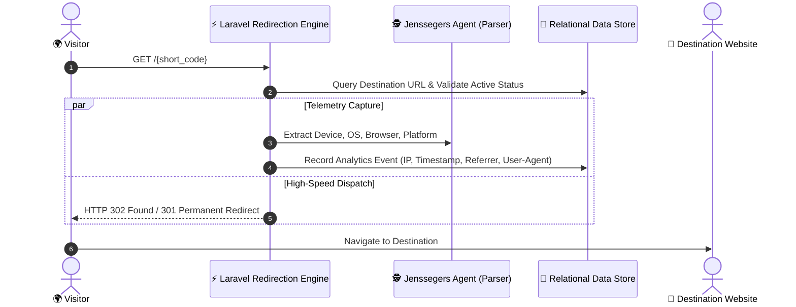

# Enterprise URL Shortener & Telemetry Analytics Platform

[](https://laravel.com)
[](https://filamentphp.com)
[](https://www.php.net)
[]()
[]()

An enterprise-ready **URL Shortening, Click Telemetry, and Traffic Analytics Platform** built on **Laravel 10** and **Filament v3**. Features high-speed slug redirection (`GET /{code}`), automated visitor telemetry inspection (operating system, browser agent, geographic IP resolution, referrer trails), and multi-tenant portal separation (Customer Analytics Workspace vs. Administrative Governance Suite).

---

## 📸 Platform Previews

| Customer Analytics Workspace | Administrative Governance Suite |
|:---:|:---:|
|  |  |
|  |  |
|  |  |
|  |  |

---

## 🏗️ Redirection & Telemetry Pipeline



---

## 🌟 Core System Capabilities

### 1. ⚡ High-Throughput URL Dispatching
- **Collision-Resistant Hash Generation:** Generates concise alphanumeric slugs mapping directly to destination URIs.
- **Soft Deletion & Life-Cycle Controls:** Disable, expire, or restore short links while maintaining historical analytical integrity.

### 2. 📊 Granular Traffic Telemetry
Powered by `jenssegers/agent` and `flowframe/laravel-trend`:
- **Client Fingerprinting:** Detects OS (Windows, macOS, iOS, Android, Linux), Browser (Chrome, Safari, Firefox, Edge), and device form factors (Mobile, Tablet, Desktop).
- **Referral Intelligence:** Tracks referrers (Direct, Social Media, Search Engines, Campaigns).
- **Time-Series Metric Aggregation:** Interactive chart visualization displaying hourly, daily, and monthly engagement trends.

### 3. 👥 Multi-Portal Filament v3 Experience
- **Customer Workspace:** Independent link management dashboard allowing clients to track their own campaigns and metrics.
- **Administrative Suite (`/admin`):** Global user management, system-wide URL inspection, domain oversight, and audit controls.

---

## 🛠️ Technology Stack

| Layer | Technologies |
|---|---|
| **Core Framework** | Laravel 10.x, PHP 8.1+ |
| **Administration Suite** | Filament v3.1 (TALL Stack) |
| **Telemetry & Analytics** | `jenssegers/agent` (Device/OS Parser), `flowframe/laravel-trend` (Time-series) |
| **Authentication & Tokens** | Laravel Sanctum, Filament Panel Guards |
| **Frontend Assets** | Tailwind CSS, Vite, Alpine.js |
| **Database** | MySQL 8.0 / PostgreSQL |
| **Code Formatting** | Laravel Pint |

---

## 📂 Domain Layout

```
laravel-url-shortner/
├── app/
│   ├── Filament/
│   │   ├── Profile/                  # Customer link workspace
│   │   └── Resources/                # Admin resources
│   │       ├── UrlResource.php       # Link management & telemetry logs
│   │       └── UserResource.php      # User account governance
│   ├── Http/Controllers/
│   │   └── UrlController.php         # High-speed redirection engine
│   └── Models/
│       ├── Url.php                   # Link entity with SoftDeletes
│       ├── UrlAnalytics.php          # Click & device telemetry
│       └── User.php                  # Customer & Admin accounts
├── images/                           # Showcase dashboard captures
├── routes/
│   └── web.php                       # Fast slug resolver (/{url})
└── composer.json
```

---

## ⚙️ Local Development & Quick Start

### Prerequisites
- **PHP:** `>= 8.1` (Extensions: `pdo_mysql`, `curl`, `mbstring`, `openssl`)
- **Composer:** `>= 2.2`
- **Node.js & NPM:** `Node 18+` / `NPM 9+`
- **Database:** MySQL 8.0+

### Setup Instructions

```bash
# 1. Clone repository
git clone https://github.com/alramim07/laravel-url-shortner.git
cd laravel-url-shortner

# 2. Install dependencies
composer install
npm install

# 3. Environment configuration
cp .env.example .env
php artisan key:generate

# 4. Database configuration in .env
# DB_CONNECTION=mysql
# DB_HOST=127.0.0.1
# DB_PORT=3306
# DB_DATABASE=url_shortener
# DB_USERNAME=root
# DB_PASSWORD=

# 5. Run database migrations & seed fixtures
php artisan migrate --seed

# 6. Link public storage & compile frontend assets
php artisan storage:link
npm run build

# 7. Start local development server
php artisan serve
```

- Customer Portal: **`http://127.0.0.1:8000/dashboard`**
- Administrative Suite: **`http://127.0.0.1:8000/admin`**

---

## 🧪 Testing & Code Formatting

```bash
# Run PHPUnit test suite
php artisan test

# Verify PSR-12 code style compliance
./vendor/bin/pint --test
```

---

## Screenshots

| Profile Dashboard | Admin Dashboard |
|-------------------|-----------------|
|  |  |
|  |  |
|  |  |
|  |  |

## Contributing

1. Fork the repository
2. Create a feature branch
3. Commit your changes
4. Push to the branch
5. Create a Pull Request

## 📄 License
This project is open-source software licensed under the [MIT License](LICENSE).

## License

This project is open-sourced software licensed under the MIT license.
