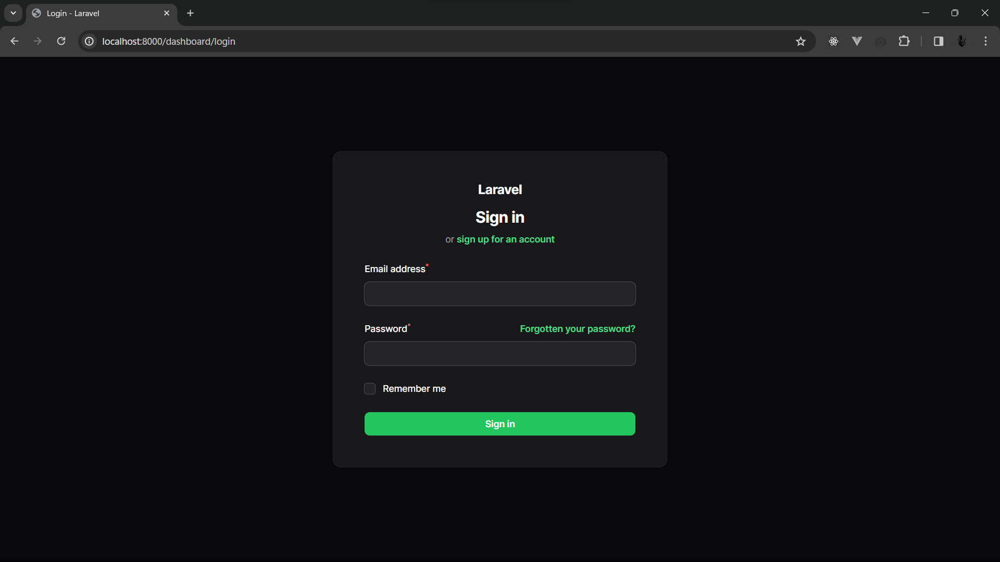
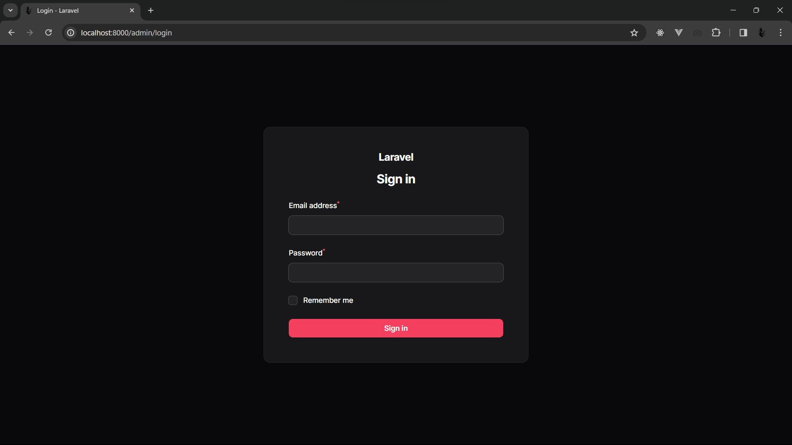
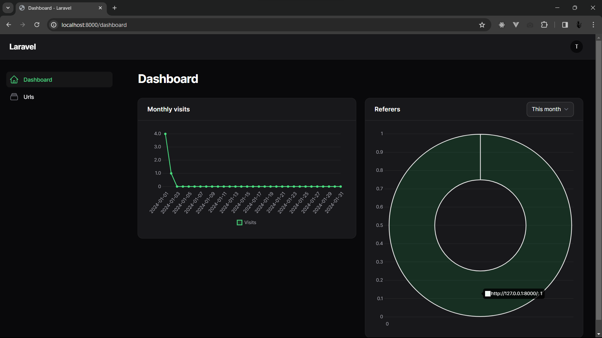
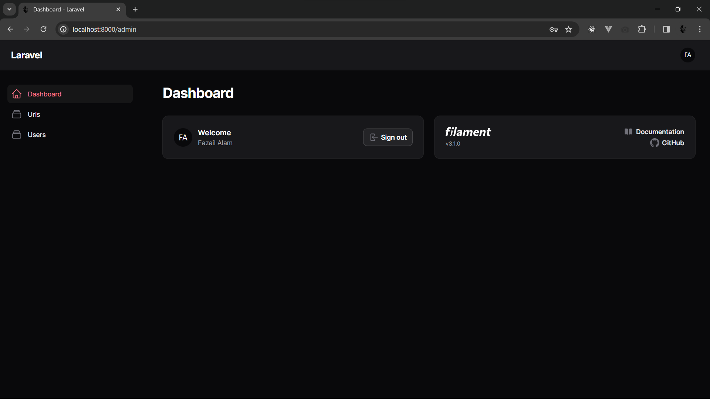
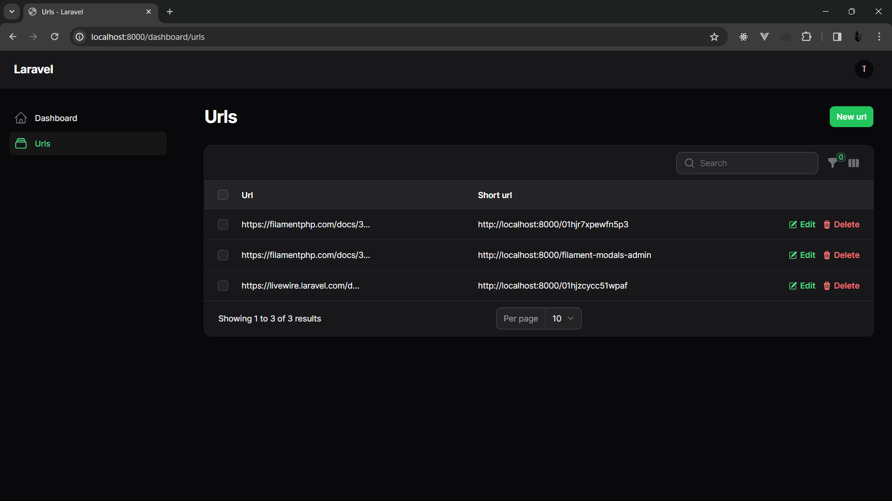
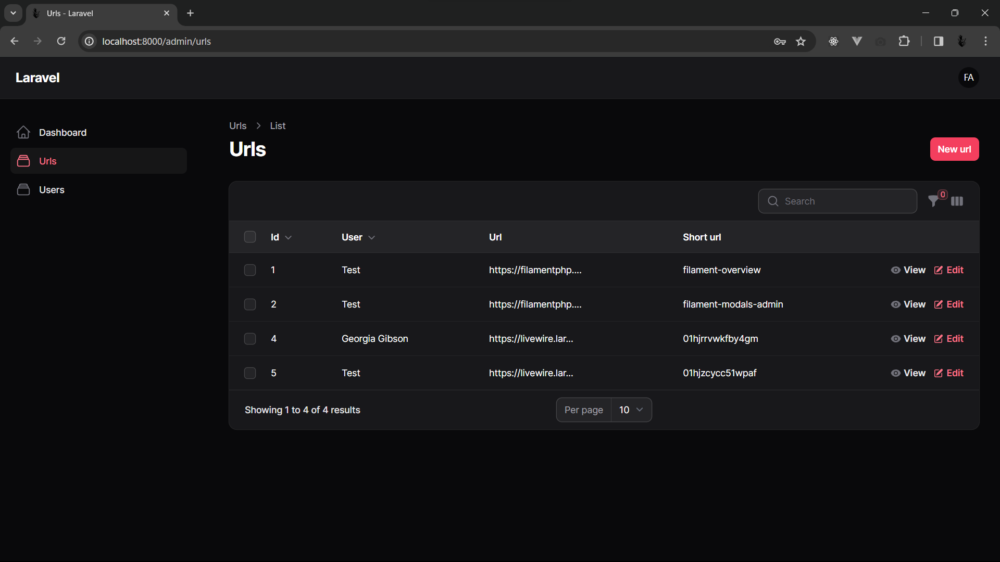
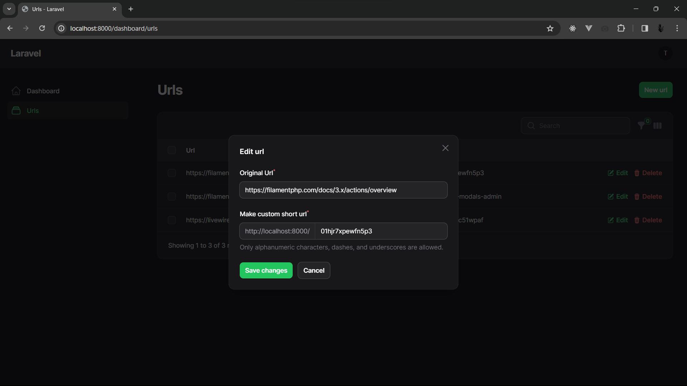
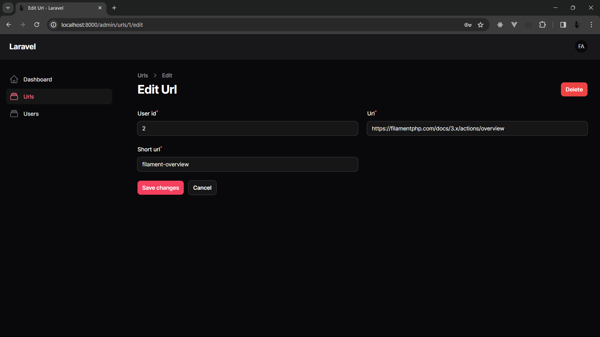

# URL Shortener

A Laravel-based URL shortener application with analytics and admin dashboard built using Filament.

## Features

- **URL Shortening**: Create short URLs that redirect to original destinations
- **User Management**: Separate admin and customer dashboards
- **Analytics**: Track clicks, devices, browsers, referrers, and geographic data
- **Admin Panel**: Full CRUD operations for URLs and users via Filament admin interface
- **Soft Deletes**: Restore deleted URLs and maintain data integrity

## Tech Stack

- **Backend**: Laravel 10.x
- **Admin Panel**: Filament 3.x
- **Frontend**: Blade templates with Vite
- **Database**: MySQL/PostgreSQL
- **Analytics**: Custom tracking with device detection

## Installation

1. Clone the repository:
```bash
git clone https://github.com/lynsromero/laravel-url-shortner.git
cd url-shortner
```

2. Install dependencies:
```bash
composer install
npm install
```

3. Environment setup:
```bash
cp .env.example .env
php artisan key:generate
```

4. Configure your database in `.env` and run migrations:
```bash
php artisan migrate
```

5. Link storage and build assets:
```bash
php artisan storage:link
npm run build
```

6. Start the development server:
```bash
php artisan serve
```

## Usage

### Creating Short URLs
- Users can create short URLs through the dashboard
- Each URL gets a unique short code for redirection
- URLs are associated with user accounts

### Analytics Tracking
- Automatic tracking of:
  - IP addresses
  - Device types and platforms
  - Browser information
  - Referrer sources
  - Language/country data

### Admin Management
- Access admin panel at `/admin`
- Manage users and URLs
- View analytics and statistics
- Soft delete and restore functionality

## API Endpoints

- `GET /{short_url}` - Redirects to original URL and tracks analytics
- Admin panel provides full CRUD operations

## Database Schema

- **users**: User accounts and authentication
- **urls**: URL mappings with short codes
- **url_analytics**: Click tracking and analytics data

## Screenshots

| Profile Dashboard | Admin Dashboard |
|-------------------|-----------------|
|  |  |
|  |  |
|  |  |
|  |  |

## Contributing

1. Fork the repository
2. Create a feature branch
3. Commit your changes
4. Push to the branch
5. Create a Pull Request

## License

This project is open-sourced software licensed under the MIT license.